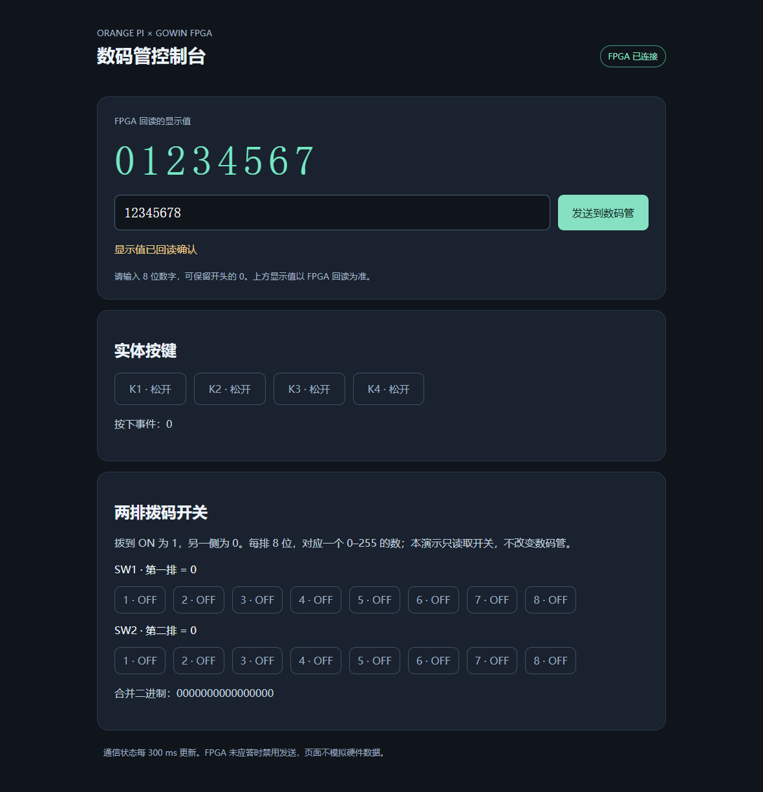

# orangepi-fpga

用网页控制 Orange Pi 主板连接的 OPi MSOC FPGA：输入 8 位数字驱动实体数码管，实时读取 4 个按键和两排拨码开关。网页显示 FPGA 回读值，硬件未连接时禁止发送。



本项目已在一套 Orange Pi AI Pro + OPi MSOC B 版硬件上运行并完成实物确认。主板和 FPGA 的具体配置见 [硬件记录](docs/hardware.md)，从编译到运行见 [部署指南](docs/deployment.md)。

## 功能

- 8 位十进制数字，可保留前导零。两组数码管显示 `0123 / 4567`。
- K1–K4 按键状态和累计按下事件，FPGA 内做 5 ms 消抖。
- 两排各 8 位拨码开关，逐位显示 ON/OFF 和每排的十进制值。
- 115200 8N1 UART，500 ms 查询一次，网页每 300 ms 更新。
- 断线后禁用发送；发送请求与 FPGA 确认值分别记录。
- 服务只监听板端回环地址，通过 SSH 转发访问。

## 快速开始

需要 Python 3、Gowin V1.9.11.03 Education 和板端已安装的 Gowin Programmer。教育版在电脑编译，Linux ARM 主板负责下载和运行网页。

```sh
git clone https://github.com/ericx-007/orangepi-fpga.git
cd orangepi-fpga
python -m pip install -r requirements.txt
```

在 `rtl` 目录运行 `gw_sh education-check.tcl`，然后回到仓库根目录运行：

```sh
python tools/adapt_bitstream.py
ssh root@BOARD_IP
# 核对并接受主机指纹后退出 SSH，再在电脑运行：
python tools/deploy.py --host BOARD_IP --bitstream rtl/impl/pnr/panel-board-id.fs
ssh -N -L 127.0.0.1:8088:127.0.0.1:8088 root@BOARD_IP
```

用真实板端地址替换 `BOARD_IP`。浏览器打开 <http://127.0.0.1:8088>。不要把这个地址发布成公网服务。

**当前只下载 SRAM，断电会恢复 FPGA 原 Flash 程序。** 重新上电后再次运行部署命令加载 SRAM。部署脚本不会改 Flash，也不会设置 systemd 开机启用。更多前置条件、错误排查及恢复步骤见 [部署指南](docs/deployment.md)。

## 已验证的范围

2026-10-23 实测：免费教育版完成综合和布局布线；FPGA DONE 置位且 CRC/ID/命令/超时错误位清零；真实浏览器发送 `87654321`、`01234567` 并获得 FPGA 回读。实物确认了显示顺序、按键计数和拨码回传。桌面与手机布局均检查通过。

Linux 软件测试使用伪串口，覆盖握手、前导零、输入校验、按键/拨码解析及断线拒绝：

```sh
python test_transport.py
```

该测试不替代 FPGA 硬件验收。GitHub Actions 只运行 Python 语法检查及伪串口测试，不编译 FPGA。

## 目录

| 路径 | 内容 |
|---|---|
| `rtl/` | FPGA RTL、已核对的引脚与时钟约束、教育版构建脚本 |
| `server.py` / `index.html` | 板端串口和 HTTP 服务、控制页 |
| `tools/` | 配置流适配、SSH 部署、SRAM 下载和 systemd 单元 |
| `docs/` | 硬件配置、部署指南、协议和截图 |

仓库不附带厂商安装包、许可证、PDF 手册、私有网络配置或密码。Gowin 教育版的使用条件以厂商条款为准。本项目的配置流 ID 适配仅在本文所列 B 版硬件上验证，不能直接用于 C 版或其他型号。
